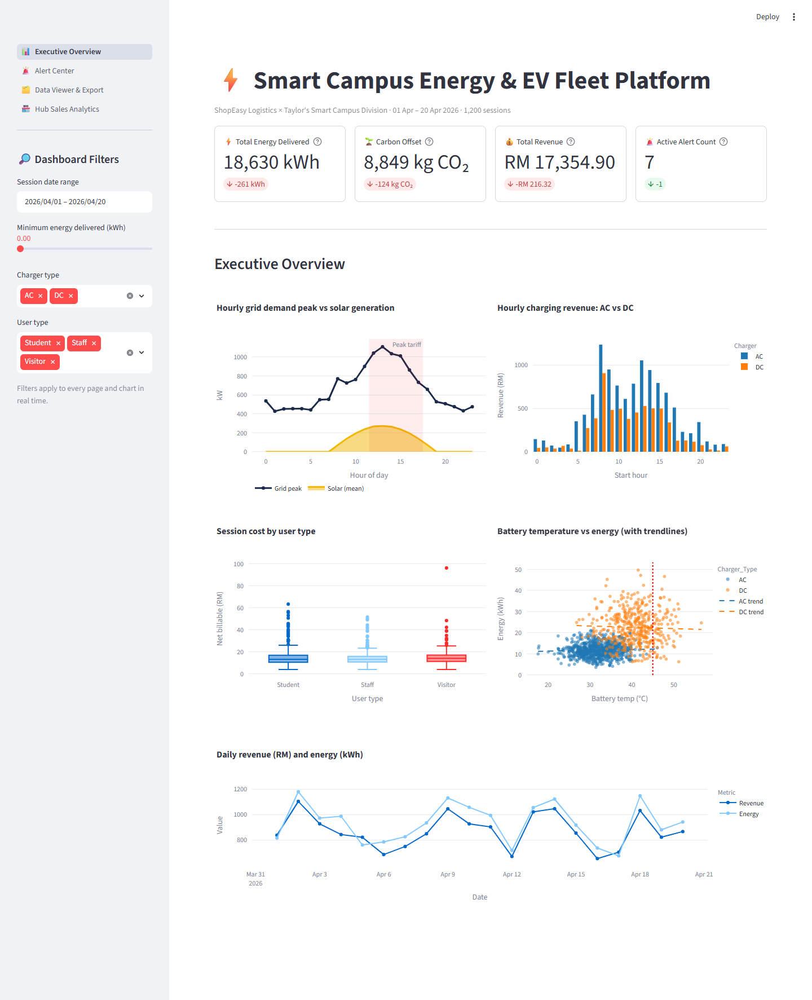
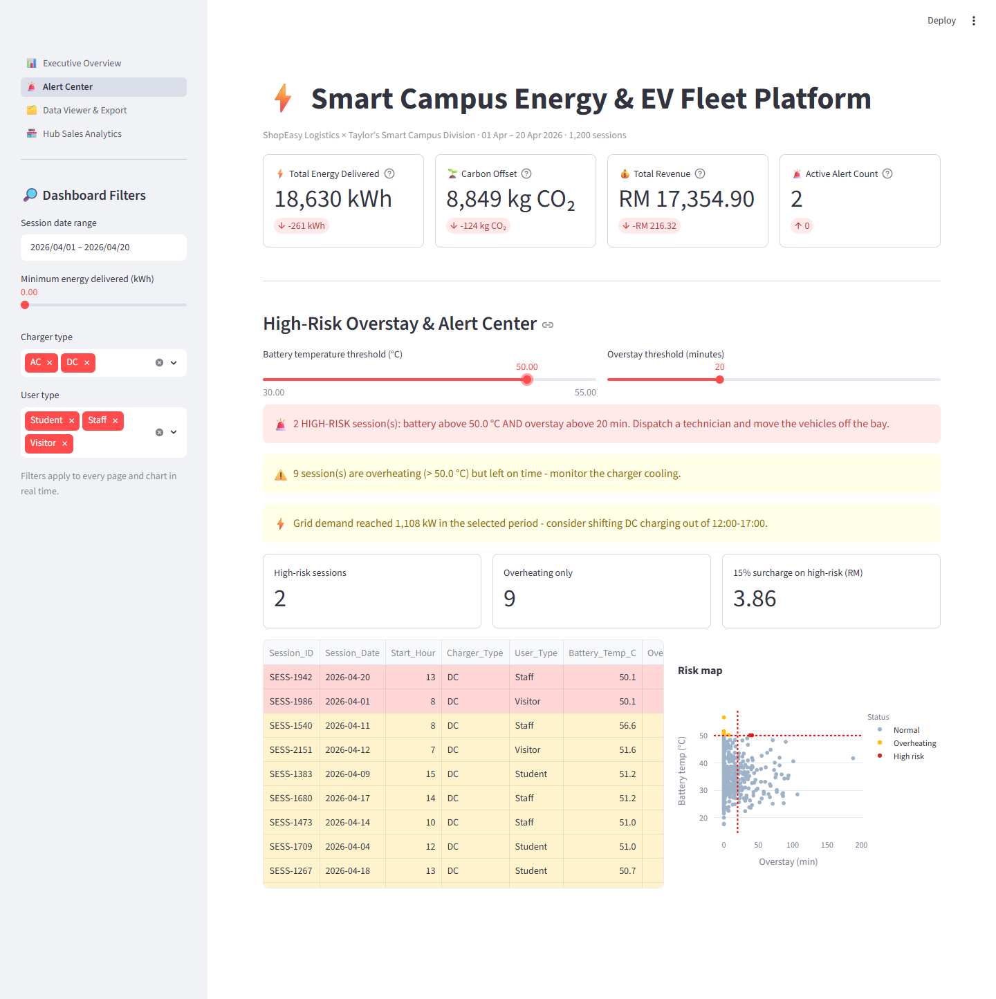
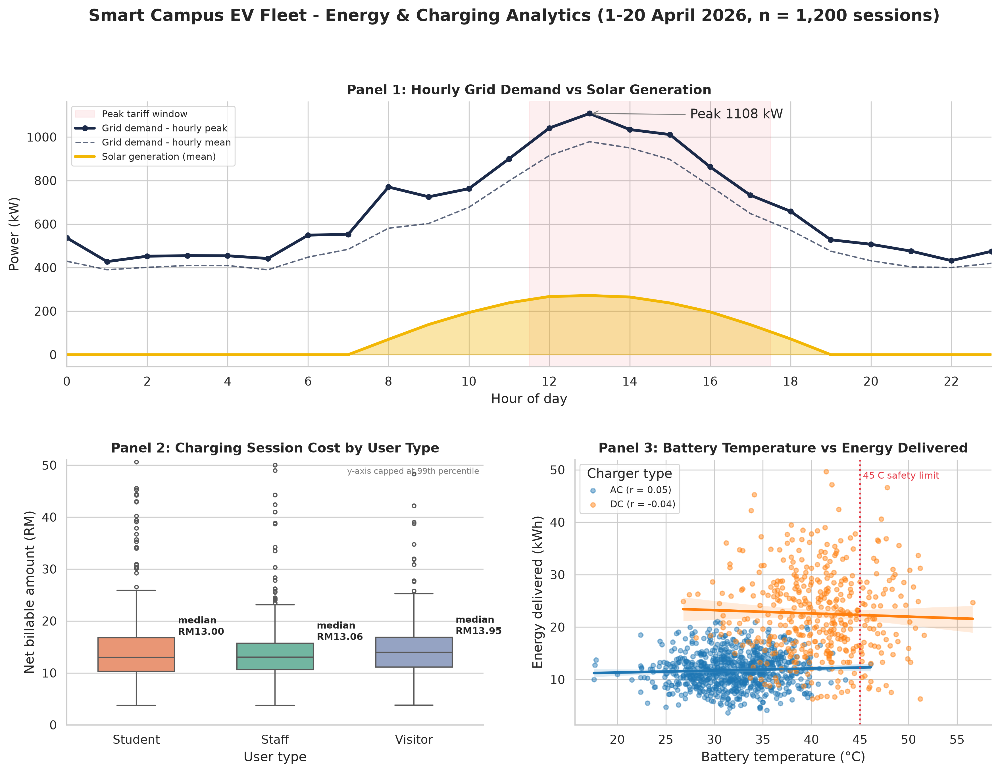

# ⚡ Smart Campus Energy & EV Fleet Platform

ITS72604 Principles of Programming – Final Exam (September 2026)

ShopEasy Logistics × Taylor's Smart Campus Division: a Python data pipeline,
publication-quality charts and a multi-page **Streamlit** dashboard that help
campus facility managers watch grid load, charging revenue, carbon savings and
battery-safety alerts.

**🌐 Live app:** https://smartcampus-ev.streamlit.app

**Video demonstration:** https://youtu.be/&lt;your-video-id&gt;

---

## Project structure

```
SmartCampus-EV-Platform/
├── app.py                      # B(c) Streamlit multi-page dashboard
├── data_pipeline.py            # B(a) cleansing, feature engineering, export
├── visualization.py            # B(b) three-panel Matplotlib/Seaborn figure
├── section_a/
│   ├── a1_numpy_pandas.py      # A(a) NumPy & Pandas operations + benchmark
│   ├── a2_functional_surcharge.py  # A(b) filter / map / reduce
│   └── a3_matplotlib_vs_seaborn.py # A(c) chart comparison
├── data/
│   ├── ev_campus_dataset.csv           # raw charging sessions (1,200)
│   ├── sales_data.csv                  # raw hub sales (500)
│   ├── cleaned_energy_sales_data.csv   # pipeline output
│   └── cleaned_sales_data.csv          # pipeline output
├── outputs/
│   ├── figures/                # PNG charts (300 dpi)
│   ├── screenshots/            # dashboard + console screenshots
│   └── *_console.txt           # captured console output
├── requirements.txt
└── README.md
```

## Quick start

```bash
pip install -r requirements.txt
python data_pipeline.py          # clean data + print summary statistics
python visualization.py          # build Section B(b) figures
streamlit run app.py             # open http://localhost:8501
```

Section A scripts (run from the project root):

```bash
python section_a/a1_numpy_pandas.py
python section_a/a2_functional_surcharge.py
python section_a/a3_matplotlib_vs_seaborn.py
```

## Dashboard pages

| Page | What it does |
|---|---|
| 📊 Executive Overview | KPI cards with deltas, grid vs solar, AC/DC revenue, cost by user type, temperature vs energy, daily trend |
| 🚨 Alert Center | Temperature & overstay sliders → `st.error` / `st.warning` / `st.success` banners, highlighted alert table, risk map |
| 🗂️ Data Viewer & Export | Column picker, `st.dataframe`, `st.download_button` CSV export |
| 🏪 Hub Sales Analytics | Revenue by hub and category, payment mix (from `sales_data.csv`) |

Sidebar filters (date range, minimum energy, charger type, user type) apply to
every page in real time.

## Business rules (recovered from the reference cleaned file)

| Feature | Rule |
|---|---|
| Power_Rate_kW | Energy_kWh / Duration_Hours |
| Carbon_Savings_kgCO2 | Energy_kWh × 0.475 |
| Base_Fee_MYR | AC RM 6/h, DC RM 15/h × Duration_Hours |
| Peak_Surge_MYR | +25 % of base fee when Start_Hour is 12–17 |
| Overstay_Fee_MYR | RM 0.50 per minute after a 15-minute grace period |
| Net_Billable_MYR | Base + peak surge + overstay |

## Simulated model columns

The raw session file has no date, weather, solar or grid data, so the pipeline
adds **synthetic, reproducible** columns (seed 72604): `Session_Date`
(1–20 Apr 2026), `Ambient_Temp_C`, `Solar_Generation_kW`, `Grid_Load_kW`
(campus base load + EV power in the same hour) and `Start/End_SoC_pct`.
See `add_simulated_columns()` in `data_pipeline.py` for the formulas.

## Screenshots




